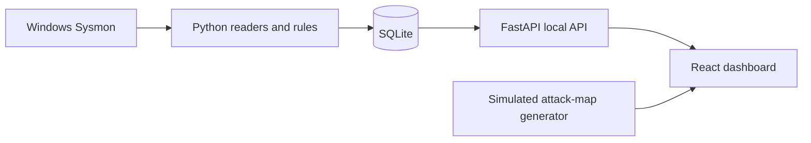

# SentinelSOC · Security Operation Center

**A local learning prototype for Sysmon events, detection rules and a SOC dashboard.**

React/TypeScript presents event and dashboard data from a Python FastAPI backend
with SQLite storage. This is a portfolio lab, not an enterprise SIEM or a
production-ready security service.

## Implemented versus planned

| Area | Current scope |
| --- | --- |
| Event ingestion | Windows Sysmon-oriented readers and event processing |
| Detection | Rules including a log-text check for `nmap.exe`; tool execution is not proof of a remote scan |
| Dashboard | Event/statistics APIs and React views |
| Authentication | Registration/login code exists, but authorization/defaults need hardening |
| Attack map | Includes randomly generated demonstration events, not a global live threat feed |
| Additional routes/widgets | Some are empty stubs; filenames do not establish implemented features |

## Local setup

Use a disposable local Windows lab for Sysmon functionality. Install Git,
Python with virtual-environment support, and Node.js/npm. Start from:

```sh
git clone https://github.com/Yuvraj-26-k/Security-Operation-Center.git
cd Security-Operation-Center
```

Backend, in a Windows terminal:

```powershell
cd backend
py -m venv .venv
.\.venv\Scripts\python.exe -m pip install -r requirements.txt
.\.venv\Scripts\python.exe -m pip install pywin32
.\.venv\Scripts\python.exe -m uvicorn app.main:app --host 127.0.0.1 --port 8000
```

Sysmon must already be installed/configured, and the running account needs
permission to read its logs. The Python Windows-event API comes from `pywin32`.
Do not install/configure system telemetry merely by following a screenshot.

Frontend, in a second terminal at the repository root:

```sh
npm ci
npm run dev -- --host 127.0.0.1
```

Use the local address printed by Vite. `/health` on the backend is a basic
process check, not verification that ingestion or all dashboard views work.
These commands reflect the tracked entry points; a clean Windows end-to-end
setup still requires verification.

## Architecture



The diagram is conceptual: inspect the active `backend/app/main.py` path before
extending older/alternate modules. Keep simulated data visibly separate.

## Security and data limitations

Keep the backend bound to loopback and use synthetic data. The reviewed
registration path assigns administrator/superuser attributes, the JWT signing
key is a hardcoded placeholder, and event/dashboard/WebSocket routes need an
authentication review. CORS configuration also needs a deliberate origin policy.
Do not expose this build publicly or use it with real client telemetry.

The tracked `.env` is empty and the audited database tables were empty. Runtime
databases/logs can later contain user and host information. The repository also
contains bytecode, an app ZIP and inactive stubs; documentation does not fix or
remove those artifacts.

## Validation and roadmap

`npm run build` and `npm run lint` are available in the frontend package.
No first-party automated test suite is currently tracked. The documentation
update does not certify a working deployment. Priorities: fix security defaults,
establish one active backend path, add deterministic ingestion/API tests and
record a sanitized end-to-end demo. No verified dashboard screenshot is
included; the decorative hero asset is not presented as one.
